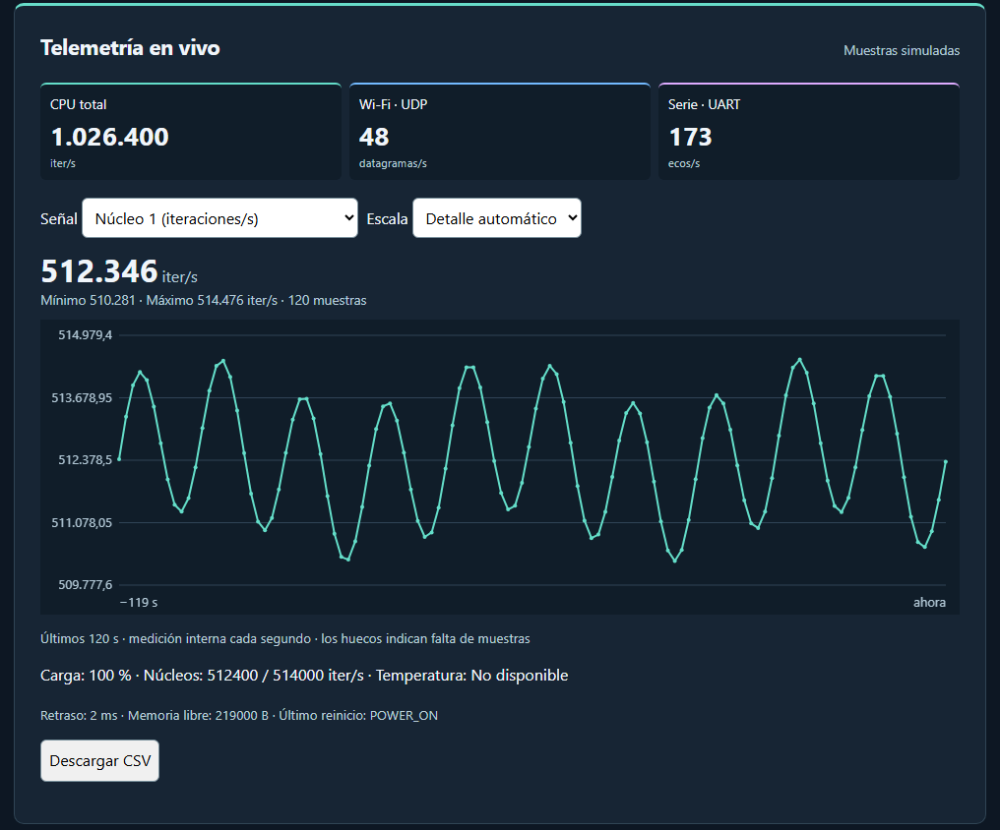

# ESP32 Stress Lab

**¿Es tu primera prueba?** Sigue el manual ilustrado desde la conexión de la placa hasta la comparación entre una fuente de referencia y un convertidor step-up o step-down. [Abrir el manual en el navegador](docs/manual.html) · [Descargar el PDF para imprimir](output/pdf/manual-esp32-stress-lab.pdf).

Firmware Arduino para aplicar carga reproducible a un ESP32 o ESP32-S3 y observar cómo responde al probar distintas fuentes de alimentación. La placa crea su propia red Wi-Fi y sirve el panel desde la memoria del firmware. Solo necesitas la placa, su alimentación y un navegador. El step-up solo alimenta la placa. Deja libres los GPIO. Todas las mediciones provienen del propio ESP32.

## Cargar el firmware y abrir el panel

1. Abre `ESP32_Power_Stress_Test__1.ino` en Arduino IDE. Conserva `portal.h` (panel web), `report.h` (estadísticas del ensayo) y `serial_load.h` (prueba interna de UART1) junto al sketch en la carpeta `ESP32_Power_Stress_Test__1`.
2. En el gestor de placas instala **esp32 by Espressif Systems**. En el gestor de bibliotecas instala **WebSockets** de Markus Sattler (en este equipo está instalada la versión 2.6.1). Selecciona tu modelo de placa y su puerto USB. Pulsa **Subir** y espera a que el IDE confirme la carga.
3. Conecta el teléfono o computador a **ESP32-Power-Test** (red abierta, sin contraseña). Si el teléfono avisa que la red carece de internet, elige mantener la conexión.
4. Abre **http://192.168.4.1/** en el navegador. El título debe ser **ESP32 Stress Lab**. Debajo aparecen la duración, los accesos rápidos y los botones **INICIAR PRUEBA** y **DETENER**.

**Primera prueba:** pulsa **1 min** y luego **INICIAR PRUEBA**. Comprueba que el estado indique **En curso** y que aparezcan muestras en **Telemetría en vivo**. Al terminar, encontrarás el resumen en **Informe automático**, debajo del gráfico.

## Ejecutar una prueba

Al abrir el panel se selecciona **Constante**, **100 %**, **Todos los disponibles** y **Generar tráfico Wi-Fi**. La radio envía también en los tramos de reposo de CPU de los patrones alternativos. Desmarca la casilla si quieres desactivar el tráfico UDP de estrés.

Para comparar un step-up con una fuente conocida usando cambios de demanda, elige **Benchmark de alimentación**, 30 minutos y 100 %. El ensayo combina 3 minutos de reposo, 12 minutos de pulsos y 15 minutos de carga sostenida. Anota qué fuente y cable utilizaste en cada pasada. Tras el ensayo de control pulsa **Guardar ensayo terminado como referencia**. Repite con el convertidor y los mismos ajustes. El informe compara automáticamente el rendimiento sostenido y los retrasos con esa referencia.

El apartado **Informe automático** aparece después de **Telemetría en vivo**. Muestra un avance durante la ejecución y el resultado al vencer el temporizador. Puedes cerrar la página y volver a abrirla después. Para guardar una copia en tu equipo, pulsa **Descargar informe de estabilidad**.

La placa conserva el último informe y la referencia en memoria no volátil. Un nuevo ensayo reemplaza el informe anterior. Si se reinicia en mitad de una prueba, al arrancar informa de la interrupción y de la causa de reinicio disponible. Las estadísticas parciales de ese ensayo se pierden. **Descargar informe de estabilidad** entrega un TXT con configuración, resultado e interpretación. El CSV sigue disponible para estudiar las muestras recibidas por el navegador.

### Añadir tráfico serie interno

Activa **Tráfico serie interno (UART1)** para sumar interrupciones y procesamiento de datos a la carga de CPU y Wi-Fi. La UART enlaza internamente TX con RX a 460800 baudios (8N1). El firmware intenta iniciar una trama de 64 bytes cada 5 ms, con un solo eco pendiente. Deja libres los GPIO y usa el monitor serie como de costumbre.

En el gráfico elige **Ecos serie verificados (tramas/s)**. El informe cuenta envíos, ecos correctos, diferencias de contenido, lecturas incompletas o fallidas y fallos de envío. Una recepción todavía incompleta al atenderla después de 100 ms se descarta. Un eco completo leído tarde cuenta como recibido y eleva el tiempo máximo. Una trama en vuelo al detener el ensayo queda como pendiente.

Compara primero el mismo montaje con la casilla desactivada y activada. Para comparar fuentes, usa la misma configuración serie en ambas. Un descenso en tramas/s con datos íntegros puede reflejar que el bucle atiende la UART con menor frecuencia. La prueba cubre el periférico y el software internos. Los cables y adaptadores externos quedan fuera de su alcance.

### Usar el Wi-Fi local

Desde el punto de acceso abre **Conexión al panel**, introduce el SSID y la clave de tu red personal de 2,4 GHz y pulsa **Conectar a la red local**. El formulario permanece en el panel mientras conecta. Cuando el router asigna una IP, el recuadro verde y la cabecera muestran el SSID confirmado por la placa y el enlace al panel. La dirección también aparece en el monitor serie. Cambia a esa red y abre la dirección indicada. La configuración dura hasta reiniciar la placa. El AP sigue disponible si las credenciales fallan o se pierde cobertura. El panel usa HTTP y permite controlar el ensayo desde equipos que puedan alcanzarlo, por lo que conviene usar una red de confianza.

También puedes abrir [CONTROL.html](CONTROL.html) directamente en tu computador. Los botones están disponibles al abrir el archivo. Para ejecutar las órdenes, conecta el equipo a la red de la placa con el firmware actualizado.

Para comparar dos convertidores en las mismas condiciones, selecciona **30 min**, **100 %**, **Pulsante**, período de **5 s** y la misma cantidad de núcleos en ambas pruebas. Mantén el tráfico Wi-Fi en el mismo estado en ambas pruebas. Pulsa **INICIAR PRUEBA** y comprueba que el estado cambie a **En curso**.

| Control | Comportamiento |
| --- | --- |
| Duración | Elige 1, 5, 10, 30 o 60 minutos, escribe una duración entera de hasta 43 200 minutos o usa 0 para dejarla sin límite en los patrones Constante, Pulsante y Rampa. El benchmark necesita una duración definida. |
| Constante | Aplica la carga seleccionada durante todo el ensayo. |
| Pulsante | Aplica la carga durante la primera mitad del período y descansa durante la segunda. Con 5 s son 2,5 s por fase. |
| Rampa | Aumenta desde cero hasta la carga elegida y repite el ciclo. |
| Núcleos | Ejecuta el trabajo en uno o dos núcleos, según los disponibles. |
| Generar tráfico Wi-Fi | Durante todo el ensayo se intentan hasta 50 envíos UDP de 1024 B por segundo a la subred del AP. El informe cuenta los envíos aceptados localmente y los intentos fallidos. |

El temporizador corre en la placa. Puedes cerrar el navegador y volver a conectarte para ver el estado y el tiempo restante. **INICIAR PRUEBA** durante una ejecución reinicia el temporizador con los parámetros del formulario. **DETENER** quita la carga. Un reinicio de la placa deja el ensayo detenido.

## Interpretar las curvas

**Telemetría en vivo** aparece debajo de los controles. Las tarjetas muestran rendimiento total de CPU, envíos UDP y ecos UART verificados. En **Señal** elige el dato que quieres inspeccionar. **Detalle automático** ajusta el eje vertical a las muestras visibles y muestra sus extremos. **Desde cero** permite juzgar cuánto representa esa variación respecto al valor total. Durante los primeros segundos el eje temporal se amplía a medida que llegan datos.



*Vista del panel con muestras simuladas para ilustrar la escala del gráfico.*

Por ejemplo, si un núcleo oscila entre 510 000 y 515 000 iter/s, **Detalle automático** hará visible la oscilación. Selecciona **Desde cero** para ver que la diferencia entre ambos extremos ronda el 1 %. Los valores actual, mínimo y máximo conservan la unidad indicada junto a la curva.

El generador UDP funciona en una tarea independiente. Se admite un envío pendiente a la vez. Ante fallos locales se espacian los intentos hasta 200 ms y, tras un envío correcto, se recupera el intervalo objetivo de 20 ms.

El gráfico usa una ventana de 120 segundos y marca los huecos de conexión. El reloj del ESP32 mide una muestra aproximadamente cada segundo. WebSocket (puerto 81) actualiza el estado hasta cuatro veces por segundo. El panel guarda cada muestra una sola vez y recurre a HTTP si deja de recibir mensajes. El tiempo de ida y vuelta del mensaje WebSocket se muestra aparte del retraso del muestreo interno.

Para comparar TXT ya descargados, abre `CONTROL.html` y usa **Comparar informes guardados**. Funciona sin conectar la placa.

- **Rendimiento por núcleo** cuenta iteraciones del trabajo de estrés por segundo. Permite comparar cuánto trabajo se completó bajo el mismo patrón.
- **Carga solicitada** muestra el porcentaje que el firmware intenta aplicar. Las tareas de Wi-Fi y del sistema también utilizan CPU.
- **Temperatura interna** lee el sensor del chip con `temperatureRead()` en el ESP32-S3. En el ESP32 clásico este firmware muestra «No disponible».
- **Retraso de muestreo** se calcula en la placa restando 1000 ms al intervalo entre dos muestras. Si transcurren 1027 ms, el retraso es de 27 ms. El informe separa los excesos de 10 a 99 ms y los de 100 ms o más. El ping del WebSocket mide otra cosa: la ida y vuelta entre la placa y el navegador.
- El panel también muestra memoria libre y causa del último reinicio. Un registro `BROWNOUT` indica que el chip registró una caída de alimentación.

Estas métricas permiten comparar síntomas de inestabilidad. Medir el rizado en milivoltios requiere instrumentar el riel de alimentación.

**Descargar CSV** exporta hasta las últimas 3600 muestras recibidas en esa pestaña, incluidos los períodos en reposo. Para conservar un registro, descarga el CSV antes de recargar o cerrar la página. Durante una desconexión la placa sigue aplicando la carga, pero el navegador deja de recoger muestras.

## Si aparecen huecos en el gráfico

Cuando pasan más de 3,5 s sin una muestra nueva, el panel indica que está recuperando la telemetría e intenta leer el estado por HTTP. Durante una desconexión, los contadores instantáneos pueden mostrar un guion. Vuelve al informe al terminar para comprobar si la placa siguió recogiendo muestras o si registró una interrupción.

Si el gráfico responde con UART sola y deja de actualizarse al añadir tráfico Wi-Fi, repite estas tres pasadas con la misma fuente, duración, carga de CPU y número de núcleos:

| Pasada | Generar tráfico Wi-Fi | Tráfico serie interno (UART1) | Qué observar |
| --- | --- | --- | --- |
| UART | Desactivado | Activado | Ecos verificados, errores y mayor demora del eco. El panel sigue accesible por Wi-Fi. |
| UDP | Activado | Desactivado | Datagramas aceptados localmente, fallos de envío y continuidad del gráfico. |
| UDP y UART | Activado | Activado | Si los huecos se repiten y cómo cambian el rendimiento y el retraso de muestreo. |

Descarga el TXT de cada pasada antes de iniciar la siguiente. Un hueco en la web por sí solo no identifica la causa eléctrica.

## Si la web no aparece

- **Ves “ESP32 Power Stress Test”, “Rail voltage” o “Idle”.** Es la interfaz antigua. Comprueba que subiste el sketch de esta carpeta al puerto de la placa que genera la red. Tras reiniciarla, reconecta al Wi-Fi y recarga la página.
- **La red aparece pero el navegador no abre el panel.** Escribe la dirección completa con `http://`. Abre el monitor serie a **115200 baudios** y reinicia la placa. La línea `ESP32 Stress Lab | ESP32-Power-Test | http://…/` indica la dirección que está sirviendo el firmware.
- **Ves el panel pero el estado indica “Sin conexión al ESP32”.** Comprueba que sigues en su red Wi-Fi. Abre `http://192.168.4.1/api/status` para comprobar si responde con el estado en JSON.

## Compilar con Arduino CLI

Desde la carpeta del sketch, con el paquete de placas de Espressif instalado, ejecuta el comando que corresponde a tu chip.

```sh
arduino-cli compile --fqbn esp32:esp32:esp32 .
arduino-cli compile --fqbn esp32:esp32:esp32s3 .
```

## Licencias

El firmware, la interfaz web y la documentación propia, incluido el manual en HTML y PDF, se distribuyen bajo [GPL-3.0-only](LICENSES/GPL-3.0-only.txt), exclusivamente en su versión 3.

La licencia para diseños de hardware propios es [CERN-OHL-S-2.0](LICENSES/CERN-OHL-S-2.0.txt). Esta versión del proyecto no incluye diseños de hardware. Los componentes de terceros conservan sus licencias originales. [Alcance por componente](LICENSE)
